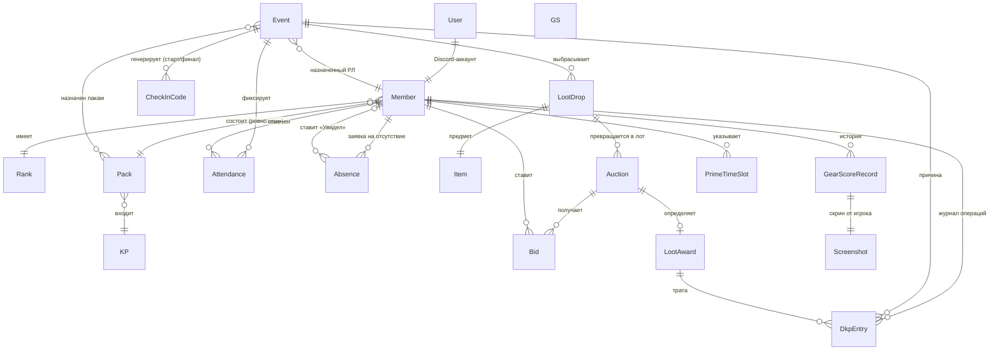

# ДКП-система гильдии — план разработки (v1.1)

> Решения гильдии собраны и зафиксированы (раздел 12) — это финальная версия,
> по ней начинаем разработку. Дальнейшие изменения правил — правками плана и
> на странице правил сайта.
>
> v0.2: стек зафиксирован — фронтенд React + Next.js, бэкенд NestJS
> (TypeScript на всём, монорепозиторий).
>
> v0.3: оргструктура Гильдия → КП → Пак; новый раздел «Отсутствия» (вместо
> предзаписи); самостоятельная отметка посещения кодом (старт/финал, 50/50
> очков); профили без аватарок, GS без модерации; роли упрощены — ранг
> «Кандидат» убран, рейд-лид стал полем ивента.
>
> v0.4: аукцион — выбран открытый формат (вариант А); добавлена логика работы
> лота и параметры: стартовая цена, минимальный шаг ставки, таймер,
> анти-снайп.
>
> v0.5: чек-ин — модалка подтверждения кода; отсутствия — без апрува, вместо
> него отметка «Увидел»; лог действий на все действия пользователей (аудит);
> гости вне гильдии на ивентах.
>
> v0.6: игровое время (день/ночь) — виджет и раскраска календаря; поле
> PvP/PvE у ивента; страницы правил (Markdown, глава/админ); аукцион — лоты
> любой длительности и настраиваемый анти-снайп (10/10 мин для длинных).
>
> v1.0: зафиксированы решения гильдии (раздел 12): плата ивента задаётся при
> создании, каждый код = 50%, без штрафов, decay и капа; классовая разметка
> предметов с наценкой «чужим» классам; причина отсутствий публична, дедлайн —
> за 3 минуты до старта; Discord-бот — приоритет (этап 6); язык — русский;
> гости убраны. Процесс: ревью опционально, вливаем по зелёному CI.
>
> v1.1 (2026-11-06): по поручению владельца перенесены все 33 решения
> ревизии UI: навигация, онбординг, аватары, приватность GS/скриншотов,
> права Офицера и лидеров, дашборд, управление ивентами, аудит и настройки.
> PLAN.md — источник требований; docs/ui — справочник представления экранов.

---

## 1. О проекте

Веб-система для гильдии в **Throne and Liberty**: расписание игровых ивентов,
учёт посещаемости (с самостоятельной отметкой кодом), оформления отсутствий,
начисление и трата ДКП-очков, аукцион выпавшего лута, профили игроков
(прайм-тайм, gear score со скриншотами), структура гильдии (КП и паки),
статистика с дашбордами.

**Исходные условия:**

| Параметр | Значение |
|---|---|
| Пользователей | до 70, одна гильдия |
| Вход | игроки — Discord OAuth; отдельный администратор — логин/пароль |
| Доступность | Россия и Латвия без VPN, HTTPS |
| Команда | несколько разработчиков разного профиля |
| Процесс | GitHub, PR-ревью, CI (линтер, тесты), автодеплой |
| Оплата хостинга | из России, рублями |
| Приоритет запуска | ядро: расписание + посещение/отсутствия + начисление ДКП |

**Важно про специфику T&L:** у игры нет публичного API персонажей, поэтому
состав гильдии, ники и gear score заполняются вручную (скрин профиля).
Типы ивентов (гильдбосс, осада, контракты и т.д.) — редактируемый справочник,
ничего игрового не зашиваем в код.

---

## 2. Функциональный обзор

### 2.1 Расписание ивентов

- Типы ивентов — справочник, редактируется офицерами (гильдбосс, осада,
  контракты, спонтанный сбор и т.п.).
- Ивент: название, тип, **режим PvP / PvE**, дата/время начала и конца, место
  сбора/комментарий, **плата ДКП за ивент** (фиксируется при создании),
  **назначенный рейд-лид** (см. 2.6), состав — открытый всей гильдии /
  закреплённый за КП или паком.
- **Повторяющиеся ивенты** по шаблону («каждый вт и чт в 20:00») — создаются
  серией: нет повторов / ежедневно / еженедельно по выбранным дням недели,
  с датой окончания серии.
- Время хранится в UTC, показывается в таймзоне игрока (Москва UTC+3,
  Рига зимой UTC+2 — календарь должен честно показывать «своё» время каждому).
  **Исключение** (решение 2026-11-06): виджет «События дня» на главной
  определяет «день» по Москве (UTC+3) для всех игроков одинаково.
- Статусы: `запланирован → идёт → завершён / отменён`.
- Предварительной записи нет: **все, кто не оформил отсутствие (раздел 2.3),
  считаются приглашёнными по умолчанию**.
- Виды: календарь (месяц/неделя) + список ближайших, фильтр по типу и режиму
  (PvE/PvP).

**Создание и управление.** Кнопка «Создать ивент» справа от переключателя
«События / Календарь». Модалка содержит название, тип из справочника,
описание, интервал начала/конца, плату (положительное целое) и РЛ из
одобренного состава. Назначение РЛ не зависит от ранга. Кнопка «Принять»
создаёт ивент; плата после создания неизменна. Глава/Админ/Офицер управляют
любыми запланированными и идущими ивентами, назначенный РЛ — своим.
Удаление разрешено только для запланированного ивента. Завершённый ивент —
просмотр и корректировка итогов Главой/Админом/назначенным РЛ, без обычного
редактирования параметров; отменённый — только просмотр (см. 2.2, 2.6).

В списке недели при отсутствии событий — «На этой неделе событий нет»;
пока событие не выбрано, правая панель показывает «Выберите событие из
списка». Строка участника в карточке: аватар, ник с рангом, класс (пара
оружий), боевая роль; GS — только Главе/Админу (см. 2.5). Участники
группируются сворачиваемыми КП/паками со счётчиками N/M.

Вкладка «События» показывает неделю пн–вс со стрелками навигации в прошлое
и будущее. В строке — дата, время, название, счётчик N/M (пойдут / все
приглашённые), кнопка «Не приду». Прошедшие события затемняются.
«Не приду» открывает модалку с необязательной причиной и «Отправить»;
создаётся отсутствие на ивент. В карточке есть «Моё участие»: «Буду» /
«Не буду», переключение на «Не буду» повторяет эту форму, на «Буду» —
отменяет отсутствие с учётом сроков 2.3.

Календарь показывает месячные плитки с помесячной навигацией, записи
отсортированы по времени; в записи — время и название. Прошедшие записи
затемнены, сегодняшний день подсвечен. До четырёх событий на день,
остальные обозначены счётчиком «+N». Клик по пустой плитке ничего не
делает; по событию — модальная карточка с тем же содержимым, что в правой
панели «Событий» и при открытии с дашборда.

**Игровое время (день/ночь).** В игре фиксированный цикл: **90 минут день →
30 минут ночь**, повторяется каждые 2 часа. От фазы зависит, как идёт событие
(ночью в подземелье для фарма включается PvP). Сайт учитывает это так:

- **Виджет в шапке** — иконка текущей фазы (солнце/луна) и обратный отсчёт до
  смены день/ночь. Точное время смены — в подсказке при наведении, на телефоне
  — по нажатию.
- **Календарь раскрашен по фазам игрового времени**: сразу видно, какая часть
  ивента попадает на ночь; ивент, накрывающий несколько фаз, — сегментирован
  день/ночь. В карточке ивента — горизонтальная полоса с цветными участками
  фаз, иконками солнца/луны и подписями времени переходов на его длительность.
- **Таймлайн внутриигровых суток — единая шкала сервера**, рассчитывается
  и показывается всем одинаково по внутриигровому времени, без перевода
  в таймзону игрока. Календарные даты начала/конца остаются в таймзоне игрока.
- Привязка цикла к реальному времени — настройка (якорная точка одной
  известной фазы), т.к. у игры нет API; длительности фаз тоже настройки.

### 2.2 Посещение и начисление ДКП

**Самостоятельная отметка кодом (как в Google-сервисах):**

1. За 3 минуты до начала ивента сайт генерирует **трёхзначный код**, который
   видят **Глава, Админ и назначенный РЛ этого ивента** на странице проведения. РЛ называет
   его в голосовом чате.
2. Каждый участник заходит на сайт, в карточке ивента нажимает «Отметиться» —
   ему показываются **4 трёхзначных кода, один из которых верный**. Выбор
   сначала показывается в **модалке подтверждения** («Код 482 — подтвердить?»),
   чтобы случайный клик не потратил единственную попытку.
3. **Окно выбора — 3 минуты.** Верный выбор → участник отметил начало,
   ему сразу начисляются **50% платы за ивент** (сумма фиксируется при
   создании ивента).
4. Неверный выбор → **попытки больше не даются** (защита от перебора),
   отметка возможна только вручную рейд-лидом.
5. **Финальный код генерируется в момент окончания ивента** — по расписанию,
   а если завершили раньше планового, РЛ запускает его кнопкой. Во время
   ивента никто ничего не вводит и не отвлекается. Отметка тем же способом:
   4 варианта, окно 3 минуты, одна попытка → **вторые 50% платы**.
6. Не успел/не смог отметиться сам (сел на работу, нет телефона) — РЛ, Глава или Админ ставит
   отметку вручную из чек-листа: `был / опоздал / ушёл раньше / неявка`.
   Оформленное отсутствие (раздел 2.3) подсвечивается в чек-листе отдельно и
   по умолчанию означает «неявка по уважительной».

Параметры (размер окна, число попыток) — настройки; доли 50/50 — решение
гильдии (раздел 12).

Три ложных варианта кода генерируются случайно. После истечения окна код
исчезает у управляющих, самостоятельная отметка закрывается; по итогам
РЛ/Глава/Админ может вручную добавить стартовую или финальную отметку.
Досрочный финальный код запускают те же управляющие.

**Автостатусы по кодам:**

| Отметки | Статус |
|---|---|
| Оба кода | «Участвовал» (`PRESENT`) |
| Только стартовый | «Ушёл раньше» (`LEFT_EARLY`) |
| Только финальный | «Опоздал» (`LATE`) |
| Ни одного, есть отсутствие на это время | «Отсутствовал по ув. причине» (`EXCUSED_ABSENCE`) |
| Ни одного, нет отсутствия | «Отсутствовал» (`NO_SHOW`) |

Один код приносит соответствующую половину платы, ни одного — ноль.
РЛ/Глава/Админ готовят корректировки по участникам: «+ код» (старт/финал),
«Ув. причина» с причиной и отсутствием за игрока на эту дату, «ДКП» —
ручной бонус или отрицательная корректировка с обоснованием.
Подготовленные изменения применяются кнопкой **«Подвести итоги»**, пишутся
в аудит; корректировки ДКП добавляются новыми записями. Эти действия
разрешены и для завершённого ивента. Отменённый ивент — только просмотр.

**Журнал ДКП (ledger) — только добавление записей.** Каждая операция: тип
(начисление чек-ина / ручное начисление / трата на аукционе / корректировка),
сумма, автор, комментарий, ссылка на ивент или лот.
Баланс игрока = сумма журнала. Ничего не удаляется и не редактируется —
«исправление» это новая запись. Это фундамент доверия к системе: любую цифру
можно раскрыть до цепочки операций, а спор решается по журналу, а не по памяти.

- Страница истории: операции по игроку / по ивенту / по автору, фильтры по
  периоду и типу.
- Ручные надбавки и корректировки — со обязательным комментарием, попадают в
  аудит-лог.

### 2.3 Отсутствия

- Игрок оформляет заявку на отсутствие: **конкретный день или период**
  (с–по), комментарий/причина. Заявку можно отменить, если планы изменились.
- **Апрува и отклонения нет:** поданная заявка сразу означает, что игрок
  отсутствует по уважительной причине — независимо от того, просмотрел ли её
  кто-то из руководства.
- Глава / Админ, а после введения КП/паков — лидер КП и лидер пака автора
  заявки, может поставить на заявке отметку
  **«Увидел»** — фиксация, что информацию приняли к сведению. На статус
  заявки отметка не влияет.
- Отметка доступна и рядом с отсутствующим участником в карточке ивента,
  и в отдельном списке отсутствий. В обоих местах это одна и та же отметка
  заявки; кнопка скрыта у пользователей без права на действие.
- Уведомления: офицерам и РЛ — о новой заявке (чтобы не пропустить и поставить
  «Увидел»).
- **В карточке ивента** (и на странице проведения) виден список тех, у кого
  оформленное отсутствие попадает на дату ивента, — РЛ их не отмечает
  вручную: статус «неявка по уважительной» ставится автоматически.
- Кто не оформил отсутствие и не пришёл — обычная «неявка»: ноль очков,
  без штрафов (решение гильдии — активность и так видна в метриках).
- Статистика отсутствий попадает в дашборды (2.8).
- Причину отсутствия видят все члены гильдии. Заявку можно подать не позже
  чем **за 3 минуты до старта ивента** (до генерации стартового кода); задним
  числом нельзя, отменить свою заявку можно тоже только до начала.

### 2.4 Аукцион лута

- Справочник предметов: название, редкость, слот, рекомендованная стартовая
  цена, **«кому нужна» (ДД / Хил / Танк / Все, мультивыбор)** — ведут офицеры.
- На ивенте рейд-лид фиксирует, что упало → создаёт лоты.
- **Формат решён: открытый аукцион с таймером и настраиваемым анти-снайпом;
  лоты любой длительности — от минут (раздача на ивенте) до дней.** Полная
  логика работы лота — в разделе 6: стартовая цена, минимальный шаг ставки,
  таймер, анти-снайп, автосписание.
- Проверка достаточности баланса при ставке; списание — автоматически при
  завершении лота (запись в журнал).
- Рейд-лид может продлить лот, отменить лот, назначить победителя вручную —
  каждое такое действие обязательно с комментарием и попадает в аудит-лог.
- **Классовая наценка:** если у предмета «кому нужна» — не «Все», игроки
  других классов всё равно участвуют в аукционе, но при победе платят
  с наценкой (настраиваемый %, предложение — +50%). В интерфейсе лота видно,
  кому предмет «родной».
- Лут-лог: кто что взял и за сколько, фильтры по игроку/ивенту/предмету.
- Лот без ставок: предмет остаётся в гильдии, передачу решает глава внутри
  игры — на сайте ничего не делаем.

### 2.5 Профили игроков

- Ник в игре, Discord, **роль в бою: Хил / ДД / Танк**, ранг, КП и пак.
- Поле ранга в интерфейсе называется **«Ранг»**, отдельно от боевой роли
  и назначений РЛ/лидеров. Класс определяется парой разных оружий RU-сервера;
  сфера и перчатки пока не предлагаются.
- **Прайм-тайм:** интервалы по дням недели («пн–чт 19:00–23:00, сб весь день») —
  редактирует сам игрок. На странице состава — фильтр «кто свободен сейчас».
- **Gear score:** игрок сам добавляет значение и **скриншот профиля персонажа**.
  Правило публикации: на скрине должны быть видны ник и GS. Проверки/апрува
  нет — ответственность на игроке.
- GS — **положительное целое число**, без дополнительных игровых порогов
  минимума/максимума. GS и подтверждающий скриншот редактируются парой;
  скриншотов может быть несколько. Форматы PNG, JPG/JPEG, WebP,
  размер каждого — **до 10 МБ включительно**. Эти требования действуют
  и в анкете первого входа.
- **Индикатор устаревшего GS:** если скрин не обновлялся больше 2 недель, рядом
  с ником игрока (состав, карточки, аукцион) появляется иконка «GS устарел».
  Актуальный GS = последняя запись со скрином.
- Баланс ДКП и полученный лут — на профиле.
- Видимость: профили и статистика — только авторизованным членам гильдии.
- **GS и подтверждающие скриншоты:** Глава/Админ видят у всех во всех местах,
  где предусмотрены эти данные. Каждый игрок видит свои в своём профиле.
  В «Составе» на вкладках «КП» и «Пак» лидер КП видит данные участников
  своей КП, лидер пака — своего пака. На других экранах лидерство и
  назначение РЛ не открывают GS. В общем списке «Участники», карточке
  ивента и виджете «Моя команда» GS видят только Глава/Админ; в чужом
  профиле GS/скриншоты тоже доступны только Главе/Админу.
  Ограничение распространяется на API-ответы, миниатюры, полноразмерные
  файлы, прямое скачивание и значения в аудите; скрыть только поле в UI
  недостаточно.
- **Аватар** — выбор в своём профиле одной из нескольких готовых
  сгенерированных иконок. Выбранная иконка едина в шапке и списках игроков.
- Свои личные поля (ник, аватар, оружия, боевая роль, GS и скриншоты)
  редактирует сам игрок. **Ранг меняют только Глава/Админ**, отдельным
  действием; личные поля чужого профиля они просматривают без редактирования.
  Изменения своего профиля также пишутся в AuditLog с автором, изменёнными
  полями, временем и комментарием к действию.

### 2.6 Роли и права

Рангов четыре: **Глава, Админ, Офицер, Рядовой**. «Рейд-лид» — не ранг,
а **поле в ивенте**: назначенный РЛ получает права ведения конкретного ивента
(коды, чек-лист, лоты, итоги) независимо от своего ранга.

| Действие | Глава | Админ | Офицер | Рядовой |
|---|:---:|:---:|:---:|:---:|
| Приём заявок, создание членов и перемещение игроков | ✅ | ✅ | — | — |
| Назначение ранга Офицер/Рядовой (Глава/Админ не назначаются через сайт) | ✅ | ✅ | — | — |
| Настройка системы | ✅ | ✅ | — | — |
| Страницы правил (редактирование) | ✅ | ✅ | — | — |
| Создание ивентов | ✅ | ✅ | ✅ | — |
| Редактирование/отмена запланированного или идущего ивента | ✅ | ✅ | ✅ | *РЛ ивента |
| Удаление запланированного ивента | ✅ | ✅ | ✅ | *РЛ ивента |
| Назначение РЛ на ивент | ✅ | ✅ | ✅ | — |
| Ведение справочника типов ивентов | ✅ | ✅ | ✅ | — |
| Ведение ивента (коды, чек-лист, итоги) | ✅ | ✅ | *РЛ ивента | *РЛ ивента |
| Ручные отметки, бонусы/штрафы и корректировки ДКП по итогам | ✅ | ✅ | *РЛ ивента | *РЛ ивента |
| Отметка «Увидел» на отсутствиях | ✅ | ✅ | — | — |
| Создание КП, смена лидера КП | ✅ | ✅ | — | — |
| Создание пака и смена лидера пака | ✅ | ✅ | †Лидер своей КП | †Лидер своей КП |
| Просмотр полного AuditLog | ✅ | ✅ | ✅ | — |
| Ведение справочника предметов | ✅ | ✅ | ✅ | — |
| **Ставки на аукционе** | ✅ | ✅ | ✅ | ✅ |
| Просмотр профилей/статистики | ✅ | ✅ | ✅ | ✅ |
| Редактирование личных полей своего профиля, кроме ранга | ✅ | ✅ | ✅ | ✅ |

\* «РЛ ивента» — права действуют только на ивентах, куда игрок назначен
рейд-лидом.

† Лидер КП/пака — назначение на соответствующей сущности, а не ранг.
Отметку «Увидел» также могут ставить лидеры КП/пака автора заявки
(этап 3), независимо от ранга. Права просмотра GS/скриншотов — отдельно
по 2.5; Офицер без других назначений их не получает.

В согласованных экранах Офицер без назначения РЛ управляет расписанием
и читает полный аудит, но не управляет составом, КП/паками или проведением
чужих ивентов. Правила справочников и аукциона описаны отдельно в 2.1/2.4/6;
UI аукциона отложен до этапа 2. После завершения ивента доступна только
корректировка итогов РЛ/Главой/Админом, после отмены — только просмотр.

Сущности «администратор сайта» и «главный в игре» — разделяем: технический
админ с полным доступом нужен всегда, даже если гильдия сменит главу.

### 2.7 Структура гильдии: КП и паки

Оргструктура: **Гильдия → КП → Пак**.

- **Пак** — базовая единица: участники, лидер пака, название.
- **КП** — объединение паков.
- **После распределения игрок состоит ровно в одном паке** (КП определяется
  через пак). При переводе игрока в другой пак история его сохраняется.
- Ивент назначается: всей гильдии / КП / паку.
- Статистика считается по пакам и КП: посещаемость, средний GS, полученный
  лут.

**Управление составом и представление:**

- Вкладки «Участники», «КП», «Пак», «Заявки». В «Участниках» поля: аватар,
  ник, ранг, КП, пак, класс, боевая роль, GS с ограничениями 2.5. Фильтры:
  КП, пак, класс, ранг и боевая роль; счётчик учитывает активные фильтры.
  Клик по игроку открывает профиль, столбцы сортируются по алфавиту.
- Во вкладках «КП»/«Пак» сначала выбирается группа; поля как в «Участниках»,
  название выбранной группы не повторяется в каждой строке. В КП игроки
  сортируются по пакам по алфавиту, в паке — по никам. Золотая корона
  отмечает лидера КП, серебряная — лидера пака.
- Глава/Админ перемещают игроков через модалку выбора КП и пака; оба поля
  редактируемы, список паков зависит от выбранной КП. Паки также можно
  переносить между КП; КП игроков определяется через пак. При переносе
  лидера (игрока из пака / пака из КП) лидерство снимается без
  автоматического назначения преемника. История сохраняется.
- Глава/Админ создают КП с обязательным названием, могут добавить паки
  из других КП. Пустую КП создавать можно.
- Глава/Админ и лидер соответствующей КП создают пак с обязательным
  названием. Глава/Админ сначала выбирают КП; у лидера его собственная
  КП предзаполнена и заблокирована. Добавлять можно только игроков этой
  КП; они переносятся из других паков. Пустой пак допустим.
- Лидера КП меняют Глава/Админ, лидера пака — они же и лидер своей КП.
  Выбор из участников группы → «Назначить» → дополнительная модалка
  с именем кандидата и названием группы → «Подтвердить». До подтверждения
  назначение не меняется. Все управляющие действия пишутся в аудит.
- Для сортировки «Моей команды» хранится дата добавления игрока в пак;
  при отсутствии используется дата регистрации. До распределения игрок
  может быть без пака; после распределения — ровно один пак.

### 2.8 Статистика и дашборды

**Главная (дашборд).** После входа у всех рангов и назначений одинаковые
четыре виджета: «События дня», «Моя команда», «Мой аукцион», «Лог действий».
Различия — в данных и доступных по правам действиях; недоступные кнопки
скрыты. На компьютере сетка 2×2 с одинаковыми размерами и внутренней
прокруткой при переполнении; на телефоне — одна колонка в указанном порядке,
высота по содержимому и общая прокрутка страницы.

- «События дня»: ближайшие 5 событий дня по Москве (UTC+3), время,
  название, тип. Старые уходят из выборки, прошедшие из показанных
  затемняются; клик открывает модальную карточку, как в календаре.
  Если событий нет — «Сегодня отдыхаем!».
- «Моя команда: {название}»: состав пака; аватар, ник, серебряная корона
  лидера пака, класс, боевая роль, GS по правилам 2.5. Лидер первый,
  остальные — по дате добавления в пак (fallback — регистрация).
  Клик — профиль игрока. Без пака: «Здесь появится информация о твоём паке
  после того, как тебя распределят».
- «Мой аукцион»: среди ставок пользователя выбирается лот с ближайшим
  окончанием; картинка, название предмета, время окончания, текущая ставка
  и её автор. Обновление при открытии страницы; кнопка «Открыть аукцион».
  Без лотов — «Скоро тут будут ваши лоты». UI аукциона — к этапу 2.
- «Лог действий»: Офицер/Глава/Админ видят 10 последних записей AuditLog
  и кнопку перехода в полный журнал. Клик по записи ничего не открывает.
  У рядового тот же виджет показывает «Журнал действий доступен Офицеру,
  Главе и Админу» без записей и кнопки. Назначения РЛ/лидеров доступа
  к полному аудиту не добавляют.

**Статистика (этап 4):**

- Посещаемость: % по игроку / паку / КП / гильдии за период (месяц, сезон),
  динамика по неделям; отсутствия (одобренные и неявки) — отдельно.
- ДКП: текущие балансы, динамика начислений и трат.
- Лут: стоимость полученного по игрокам/пакам (кто сколько «съел» бюджета).
- Активность: участие в ивентах по типам и режиму (PvE/PvP), пик по времени.
- Свежесть GS: доля игроков с устаревшим скрином.
- Экспорт CSV любой таблицы.
- Ограничения GS/скриншотов из 2.5 действуют и в статистике, фильтрах,
  экспорте и связанных API-ответах.

### 2.9 Сквозные вещи

- **Вход через Discord** (OAuth2). Первый экран для всех — welcome с кнопкой
  «Связать с Discord» и входом администратора по логину-паролю. Вход через
  Discord заполняет анкету (ник, оружия, роль, GS+скрин); доступ к сайту —
  после одобрения главой или админом (онбординг). Единственный Глава
  назначается при инициализации (не «первый вошедший»); роль Главы нельзя
  назначить или передать через сайт.
- Администратор — один профиль, входит только по логину-паролю (без Discord),
  роль не назначается никому.
- Экран приветствия доступен по `/`; одобренному вошедшему пользователю
  тот же адрес открывает дашборд. Приветствие, первая анкета и ожидание
  одобрения показываются **без шапки и бокового меню**.
- «Вход для Админа» открывает **модалку** логина/пароля. При ошибке под
  формой — «Неверный логин или пароль», введённый логин сохраняется.
  Лимит — **5 запросов за 15 минут с одного IP**, включая успешные;
  превышение — HTTP 429, сообщение о временном ограничении и сохранение
  логина. Восстановления пароля нет; секреты хранятся в настройках
  окружения/секретах проекта, не в исходниках.
- Все поля первой анкеты обязательны: ник, класс (два разных RU-оружия),
  боевая роль, положительный целый GS и подтверждающий скриншот (2.5).
  Пока заявка не принята, доступны редактирование анкеты и выход.
  Заявки видят и принимают только Глава/Админ — в «Заявках» состава и
  профиле заявителя. Отклонения нет, ожидание бессрочное; уведомление
  о принятии пока не делается. Одобрение допуска на сайт не является
  отдельной модерацией значения GS.
- Отметка «Увидел» на отсутствиях: Глава, Админ, лидер КП и лидер пачки
  автора заявки (КП/пачки — этап 3).
- Уведомления: основной канал — **Discord-бот** (анонс ивента, напоминание
  за N минут, новые заявки об отсутствии, результат лота; этап 6). Центр
  уведомлений на сайте — по остаточному принципу, после бота.
- **Лог действий (аудит) — на все действия пользователей:** входы,
  административные изменения (роли, правила, справочники), проведение ивентов
  (ручные отметки, запуск кодов, продления), аукцион (ставки, ручное
  назначение победителя, отмена лота), отметки «Увидел» на отсутствиях,
  изменения своего профиля (ник, оружия, боевая роль, GS, скриншоты, аватар).
  Каждая запись: кто, что, когда, с каким объектом; для ручных действий —
  обязательный комментарий. Цель — сразу видно, если кто-то с правами
  пользуется ими недобросовестно (например, раздаёт лут себе через ручное
  назначение). Полный журнал доступен офицерам и выше; публичные части
  (журнал ДКП, лут-лог) — всем.
- Формат полного журнала — лента «кто / что / над чем / когда», новые
  записи первыми, без ссылок из записей и без счётчика общего числа.
  Размер страницы: **10 / 50 / 100**. Фильтры: плоский тип сущности
  (ДКП / КП / пак / лот / событие), автор и диапазон дат. Каждый
  необязателен, работают по одному или в любых комбинациях через **И**.
  Системные действия имеют автора «Система», в фильтре отдельная опция.
  Чек-ин коды в лог не пишутся — только факт генерации. Полный аудит
  защищён на API; его доступность не раскрывает GS/скриншоты без прав 2.5.
- Адаптивная вёрстка: телефон — полноценный сценарий (отметиться кодом с
  телефона — святое).
- Язык интерфейса — только русский.

### 2.10 Правила гильдии и правила сайта

- Две страницы: **«Правила гильдии»** и **«Правила пользования сайтом»**.
- Просмотр — всем членам гильдии; редактирование — **только Глава и Админ**,
  кнопка «Редактировать» прямо на странице.
- Формат — **Markdown с эмодзи**: заголовки, списки, таблицы, картинки,
  смайлики; редактор с предпросмотром.
- Все изменения — в лог действий; хранится **история версий** правил, можно
  посмотреть и откатиться к предыдущей.

### 2.11 Общие элементы интерфейса

- Шапка и боковая шторка показаны на экранах одобренных пользователей,
  кроме экранов входа/анкеты/ожидания (2.9). В шапке: герб и название
  гильдии (клик — дашборд), игровое время (2.1), баланс ДКП как некликабельная
  цифра, выбранный аватар, ник (клик по нику/аватару — профиль), текстовый
  бейдж **«Ранг»** и кнопка «Выход» с подтверждением, ведущая на приветствие.
- Значения ранга: «Глава», «Админ», «Офицер», «Рядовой». Лидерство КП/пака
  обозначается отдельно золотой/серебряной короной, РЛ — назначение ивента.
- В меню обычный регистр: «Дашборд», «Расписание», «Состав гильдии»,
  «Аукцион», «Лог действий», «Настройки». Основные разделы доступны всем
  одобренным игрокам; полный лог — Офицеру/Главе/Админу, настройки —
  Главе/Админу. Аукцион добавляется на этапе 2.
- **Недоступные по правам пункты меню и кнопки скрываются на всех экранах**.
  Временная блокировка при отправке формы не является отсутствием права.
- Шторка слева, по умолчанию свёрнута до иконок; раскрывается кнопкой
  с тремя полосками, активный раздел подсвечен. Состояние запоминается
  между страницами и сессиями. На телефоне раскрывается поверх шапки.

### 2.12 Настройки системы

- Единый экран для Главы/Админа со всеми текущими и будущими настройками,
  сгруппированными по разделам (ДКП, чек-ин, отсутствия, аукцион, общие).
  Источник ограничений и дефолтов — общий реестр `SETTINGS_REGISTRY` /
  `SETTING_DEFAULTS`; игровые значения хранятся в `Setting`. Настройки
  игрового цикла (якорь, длительности дня/ночи) хранятся на `Guild`.
- При изменениях появляется «Сохранить», без изменений кнопки нет.
  Неверное значение сопровождается пояснением у поля. При ошибке
  сохранения введённые значения остаются в форме и показывается сообщение.
- **«Сбросить к дефолтам»** — по разделам, с подтверждением; заполняет
  только форму выбранного раздела. На сервере значения меняются после
  «Сохранить», изменения пишутся в AuditLog. Отмена подтверждения
  сохраняет форму. Для игрового цикла сбрасываются длительности фаз,
  якорь остаётся известной серверной привязкой, без универсального дефолта.

---

## 3. Доменная модель

Принципиальные решения:

1. **DkpEntry — append-only журнал**, балансы нигде не хранятся как «главная
   правда», только вычисляются из журнала (+ периодический снапшот для
   скорости дашбордов).
2. **Посещение, чек-ин коды и ставки ссылаются на ивент** — статистика
   выводится из фактов, а не дублируется.
3. **CheckInCode хранит только хэш кода и окно действия** — сам код не
   раскрывается пользователям без права; его видят Глава, Админ и
   назначенный РЛ ивента.
4. **Гильдия — одна**, но сущность заложена: если позже понадобится альянс —
   это добавление, а не переделка.

---

## 4. Ключевые сценарии

**Сценарий 1 — недельный цикл рейд-лида.** Офицер создал серию ивентов из шаблона
(вт, чт 20:00), назначил РЛ. Накануне РЛ видит в карточке, кто оформил отсутствие. За 3
минуты до старта сайт сгенерил код — РЛ огласил его в войсе; участники
отметились сами (по +половине очков), кто-то ошибся или не успел — РЛ отметил
вручную. В конце — второй код, вторые половины. Итоговая сводка ивента:
кто сколько получил, всё ушло в журнал ДКП.

**Сценарий 2 — аукцион.** Упал предмет → РЛ создаёт лот → игроки ставят
(открыто с таймером) → лот закрыт → победитель получил предмет,
списание ушло в журнал ДКП автоматически.

**Сценарий 3 — GS.** Игрок собрал новый шмот, сделал скрин профиля (видны ник
и GS), загрузил, указал значение. GS обновился во всех разрешённых местах по 2.5. Через две с
половиной недели скрин не обновляли — рядом с ником появилась иконка «GS
устарел»; просмотр данных GS в составе подчиняется ограничениям 2.5.

**Сценарий 4 — отсутствие.** Игрок уезжает на выходные → оформил заявку на
период пт–вс с комментарием → Глава/Админ либо лидер своей КП/пака поставил «Увидел» (или не поставил — на
статус не влияет) → в карточках попадающих на эти дни ивентов игрок уже
числится отсутствующим по уважительной, РЛ его не разбирает, неявкой это не
считается.

**Сценарий 5 — спор.** «А почему у меня меньше очков?» → открыли историю
операций игрока → каждая строка с автором, датой и ссылкой на ивент. Спор
закрыт фактами.

---

## 5. Механики ДКП — зафиксированные решения

Это игровые правила, не технические — решения приняты гильдией. Суммы (плата
за ивент, размер наценки) — настройки, меняются без правки кода.

| Тема | Решение |
|---|---|
| Начисление за ивент | Плата фиксируется при создании ивента; каждый чек-ин код приносит ровно 50% платы (механика — в 2.2) |
| Не успел в окно чек-ина | Отмечает РЛ вручную: начислить 50% или ничего — его решение |
| Неявка без оформленного отсутствия | Штрафов нет: ноль очков, активность видна в метриках |
| Decay и кап баланса | Не вводим |
| Приоритеты на лут | Классовая разметка «кому нужна» + наценка «чужим» классам (настраиваемый %) — см. 2.4 и 6 |
| Лот без ставок | Предмет остаётся в гильдии, передача — решением главы в игре |

---

## 6. Аукцион — выбранный формат и логика работы

**Решено: вариант А — открытый аукцион с таймером.** Скрытые ставки из объёма
убраны. Ставки видны всем в реальном времени, побеждает автор последней
валидной ставки на момент истечения таймера.

**Жизненный цикл лота:**

1. РЛ на странице проведения ивента создаёт лот: предмет из справочника,
   стартовая цена, минимальный шаг ставки, длительность торгов. Значения
   подставляются из настроек аукциона, РЛ может поменять под конкретный лот.
2. Первая ставка — не ниже стартовой цены. Каждая следующая — не ниже
   текущей + **минимальный шаг**; меньшую система не принимает.
3. Длительность лота задаёт РЛ: **«живая раздача»** — 60–90 секунд, таймер от
   первой ставки; **длинный лот** — на дни (например, пара дней по запросу
   главы гильдии), таймер от открытия лота. Если за отведённое время ставок
   нет — лот закрывается как «без ставок».
4. **Анти-снайп — настраиваемый:** ставка меньше чем за N до конца лота
   продлевает лот на N. Для живой раздачи — 30 сек/30 сек; для длинных лотов —
   10 мин/10 мин (ставка за 10 минут до конца продлевает аукцион на 10 минут).
5. При ставке проверяется баланс: поставить больше своего баланса нельзя.
6. **Классовая наценка:** у предмета поле «кому нужна» (ДД/Хил/Танк/Все).
   Игрок «чужого» класса участвует наравне, но при победе платит с наценкой
   (настраиваемый %, предложение — +50%); в интерфейсе сразу видно, кому
   предмет «родной».
7. Истечение таймера → лот закрыт, автор последней ставки побеждает:
   получает предмет, списание (с наценкой, если применимо) автоматически
   уходит в журнал ДКП.
8. РЛ может продлить лот, отменить его, назначить победителя вручную —
   каждое действие с комментарием и попадает в аудит-лог.
9. Лот без ставок: предмет остаётся в гильдии, передача — решением главы
   внутри игры; на сайте ничего не делаем.

**Параметры аукциона — настройки с дефолтами (стартовые предложения):**

| Параметр | Дефолт |
|---|---|
| Стартовая цена лота | рекомендованная цена предмета из справочника (если задана), иначе 0 |
| Минимальный шаг ставки | 1 очко |
| Наценка «чужому» классу | +50% (предложение, настройка) |
| Длительность лота | живая раздача: 60 сек от первой ставки; длинный лот: 1–2 дня от открытия |
| Анти-снайп (окно/продление) | 30 сек / 30 сек — живая раздача; 10 мин / 10 мин — длинные лоты |
| Тайм-аут лота без ставок (живая раздача) | 2 минуты |

*Почему вариант А (для истории решения):* максимальная прозрачность и
доверие — все видят все ставки, открытая борьба дисциплинирует траты. Скрытые
ставки быстрее, но порождают подозрения в сговоре и требуют больше правил.

---

## 7. Технический стек

Стек не самоцель; критерии: разнородная команда, до 70 пользователей
(нагрузка мизерная), минимум собственной инфраструктуры и **одна экосистема на
весь проект**. Фронтенд зафиксирован решением команды — React + Next.js; бэкенд
выбран в ту же экосистему: TypeScript и там, и там.

**Итоговый вариант — монорепозиторий на TypeScript:**

| Слой | Технология | Почему |
|---|---|---|
| Фронтенд | **Next.js (React, TypeScript) + Tailwind CSS** | Зафиксировано; удобный роутинг и «батарейки» из коробки; дашборды — Apache ECharts |
| Бэкенд | **NestJS** | Зрелый фреймворк со структурой из коробки: модули, DI, **guards для матрицы прав**, встроенный Swagger (OpenAPI) |
| БД / ORM | **PostgreSQL 16 + Prisma** | Типобезопасные запросы и миграции |
| Realtime | **Socket.IO (gateway в NestJS) + Redis adapter** | Живой аукцион: ставки, таймер, анти-снайп; таймеры чек-ин кодов |
| Общие типы | Пакет `@dkp/shared` внутри монорепо | DTO и zod-схемы одни на бэк и фронт — фронт не разъедется с API |
| Кэш/очереди | Redis + BullMQ | Pub/sub аукциона, генерация и сгорание кодов, отложенные задачи (decay, напоминания) |
| Файлы (скрины) | Локальный том, ресайз на входе | 70 человек — S3 не нужен; при росте → MinIO |
| Auth | Passport + Discord OAuth2 в NestJS, httpOnly-cookie | Единая сессия для API и SSR-страниц Next |
| Инструменты | pnpm workspaces + Turborepo, eslint + prettier, TypeScript strict | Один язык, один конфиг на всё монорепо |
| Контейнеры | Docker + docker-compose | Одинаково у всех девов и на сервере |

**Почему бэкенд не Django/DRF** (вариант рассматривался): его главный козырь —
готовая админ-панель, но наши админ-экраны (отсутствия, журнал ДКП, лоты) всё
равно кастомные, и их логичнее строить в том же Next.js с проверкой прав. А
один язык на весь проект для разнородной команды — это общие типы, одна
CI-цепочка и меньше переключений контекста. Если в команду придут в основном
Python-разработчики — API-контракт (REST + OpenAPI) позволит перевести бэкенд
на Django + DRF без переделки фронта.

Что фиксируется независимо от стека: REST API со спецификацией OpenAPI,
миграции БД обязательны, линтеры и тесты в CI (раздел 9), разделение бэка и
фронта по API.

---

## 8. Инфраструктура и хостинг

**Требование:** доступность из РФ и Латвии без VPN, оплата рублями.

- **VPS у российского провайдера с локацией в ЕС** — Selectel (Амстердам) или
  Timeweb Cloud (Нидерланды): оплата картой РФ, сервер физически в Европе →
  отлично для Латвии, а российский провайдер из РФ не блокируется.
- Конфигурация: 2 vCPU / 4 ГБ / SSD — хватит с запасом (наши нагрузки
  микроскопические). **~1000–2500 ₽/мес** + домен ~200–900 ₽/год
  (reg.ru, `.com` или `.ru`).
- Без Cloudflare-проксирования (в РФ периодически деградирует) — просто DNS.
- Реверс-прокси **Caddy**: автоматический HTTPS от Let's Encrypt.
- Всё в docker-compose: `api` (NestJS), `web` (Next.js, SSR), postgres,
  redis, uptime-мониторинг (Uptime Kuma), ошибки — Sentry (free tier).
- **Бэкапы:** ежедневный pg_dump + архив скриншотов, хранение 30 дней,
  выгрузка в отдельное хранилище; раз в месяц — контрольное восстановление.
- Отдельное окружение **staging** (тот же сервер, поддомен) с тестовыми
  данными — там смотрим фичи до продакшена.

---

## 9. CI/CD и процесс разработки

**GitHub-процесс:**

- `main` — защищённая ветка (прод). Ветки `feature/...` → Pull Request.
- **Ревью опционально:** разработчикам верим на слово — лить можно без
  апрувов, обязательное условие одно — зелёный CI. Нужно мнение со стороны
  (сложная логика, ядро ДКП) — просто позвать ревьюера в PR, это не блокер.
- Осмысленные коммиты, шаблон PR (что/зачем/как проверить/скриншоты UI).

**Пайплайн GitHub Actions на каждый PR:**

1. Линт и форматирование всего монорепо: `eslint` + `prettier`.
2. Проверка типов: `tsc` (strict, единый base-конфиг на монорепо).
3. Тесты бэкенда: `jest` + `supertest` на API, покрытие (порог 80% на ядре:
   журнал ДКП, права, окна чек-ин кодов).
4. Тесты фронтенда: `vitest` + Testing Library (юнит компонентов/логики).
5. Сборка docker-образов (проверка, что собирается) — публикация в GHCR.
6. Аудит зависимостей: `pnpm audit`.
7. E2E-смоук Playwright (после деплоя на staging): вход, создание ивента,
   чек-ин кодом, заявка на отсутствие, ставка на аукционе — 4–5 ключевых
   сценариев.

**Деплой:** вливание в `main` → автодеплой на **staging** + смоук-тесты →
деплой на **прод** по тегу версии вручную (кнопка в Actions с подтверждением),
миграции БД применяются автоматически, перед ними снапшот БД.

**Тестирование (стратегия):** юнит-тесты на всю денежную логику (журнал ДКП,
анти-снайп, права, окна кодов) — обязательны в том же PR; API-тесты на ключевые
эндпоинты; e2e-смоук на сценарии выше; ручной чек-лист перед каждым релизом.

---

## 10. Этапы разработки

Оценки — при 2–3 разработчиках по вечерам. Этапы независимы, после каждого —
работающая версия в проде, которой уже можно пользоваться.

| Этап | Срок | Содержание | Результат |
|---|---|---|---|
| **0. Каркас** | 1 нед | Монорепо (pnpm workspaces + Turborepo), CI-пайплайн, docker-compose для локальной разработки, финализация модели данных (Prisma-схема), черновики экранов | Пустое приложение с зелёным CI, деплоем на staging |
| **1. Ядро (MVP)** | 3–4 нед | Вход через Discord, члены и ранги (матрица прав, РЛ как поле ивента), расписание + серии ивентов + игровое время (раскраска день/ночь, виджет, поле PvP/PvE), чек-ин кодом (старт/финал, 50/50, модалка подтверждения), ручные отметки РЛ, заявки на отсутствие (без апрува, отметки «Увидел») + отображение в карточке, журнал ДКП + история операций, лог действий (аудит), страницы правил (Markdown, глава/админ), страница состава, базовый профиль | **Гильдия уже ведёт ивенты, отсутствия и ДКП на сайте** |
| **2. Аукцион** | 2–3 нед | Справочник предметов («кому нужна»), фиксация дропа, открытые лоты любой длительности (от минут до дней) с настраиваемым анти-снайпом, классовая наценка, realtime-ставки, автосписание, лут-лог, аудит действий РЛ (логика — раздел 6) | Полный цикл лута |
| **3. КП/паки и профили+** | 2 нед | КП и паки (игрок в одном паке), назначение ивентов пакам/КП, прайм-тайм, GS-скрины + индикатор устаревания | Структура гильдии в системе |
| **4. Статистика** | 2 нед | Дашборды посещаемости/отсутствий/ДКП/лута, свежесть GS, фильтры, экспорт CSV | Картинка для офицеров |
| **5. Полировка и запуск** | 1–2 нед | Мобильная доводка, безопасность (rate limit на ставки/логин/чек-ин, приватность), бэкапы, проверка восстановления, перенос на прод | Релиз v1.0 |
| **6. Discord-бот** | 1–2 нед | Анонсы ивентов, напоминания за N минут, новые заявки об отсутствии, результаты лотов; привязка к каналам гильдии | Уведомления приходят в Discord |

Итого полный объём ≈ **3,5–4 месяца** (включая Discord-бот), MVP — ≈ через
1,5–2 месяца.

**Вторая очередь (после v1.0, по приоритетам гильдии):** синхронизация
рангов с Discord-ролями, центр уведомлений на сайте, автоматический decay
(если гильдия передумает).

---

## 11. Риски

| Риск | Мера |
|---|---|
| Волонтёрское время, кто-то выгорает/пропадает | Этапность, простые технологии, документация решений в репо, каждый этап — рабочий продукт |
| Споры о правилах ДКП | Всё в прозрачном журнале; правила — страницы на сайте; изменения — только глава/админ, с аудитом и историей версий |
| Недоверие к цифрам («система обманывает») | Append-only журнал, публичный лут-лог, любой баланс раскрывается до операций |
| «Не успел отметиться кодом» — жалобы | Ручная отметка РЛ всегда доступна; параметры окна настраиваются |
| Один сервер — одна точка отказа | Ежедневные бэкапы + контрольное восстановление + мониторинг |
| Discord API недоступен | Резервный вход админа, кэш профилей |
| Смена правил посреди сезона | Версионирование правил, у каждой операции в журнале — версия правил на момент начисления |

---

## 12. Решения гильдии (зафиксировано)

1. **Начисление:** плата за ивент фиксируется в момент создания ивента;
   каждый чек-ин код (старт и финал) приносит ровно 50% платы. Штрафов за
   неявку без уважительной причины нет — активность и так видна в метриках.
2. **Аукцион:** формат открытый, параметры — раздел 6. Вместо приоритетов —
   классовая разметка предметов «кому нужна» (ДД/Хил/Танк/Все) и наценка для
   «чужих» классов (настраиваемый %).
3. **Decay и кап баланса:** не вводим.
4. **Публичность:** балансы и лут-лог видны всем членам гильдии.
5. **Лот без ставок:** предмет остаётся в гильдии, передачу глава гильдии
   решает внутри игры; на сайте ничего не делаем.
6. **Отсутствия:** причину видят все; заявку можно подать не позже чем за
   3 минуты до старта ивента, задним числом нельзя.
7. **Чек-ин кодом:** параметры подтверждены — стартовый код за 3 мин до
   начала, финальный в момент окончания, окно 3 мин, одна попытка, 50/50.
8. **Уведомления:** приоритет — Discord-бот (включён в план, этап 6); центр
   уведомлений на сайте — вторично.
9. **Язык интерфейса:** только русский.
10. **Гости:** не заводим; ДКП начисляется только членам гильдии.
11. **Разделение прав (ревизия UI, 2026-11-06):** Офицер без дополнительных
    назначений управляет расписанием и читает полный аудит; управление
    составом и КП/паками ограничено Главой/Админом и правами лидера своей
    КП. Коды, проведение и итоги — Глава/Админ/назначенный РЛ (см. 2.6).
    Свои личные поля редактирует игрок; ранг — только Глава/Админ.
    Все ручные изменения пишутся в аудит с комментарием.
12. **Роли Главы и Админа (ревью этапа 1):** Глава — единственный, назначается
    при инициализации, через сайт не назначается и не передаётся; первый
    вошедший Discord-пользователь Главой больше не становится. Админ — один
    профиль, входит только по логину-паролю (без Discord), роль не назначается.
13. **Первый экран:** для всех гостей — welcome («Связать с Discord» / вход
    для администратора); после Discord-входа — анкета и ожидание одобрения
    главой/админом, без доступа к сайту до одобрения. Вошедшие попадают на
    дашборд со сводной информацией.
14. **Аватары и приватность GS:** готовые сгенерированные иконки на выбор;
    GS/скриншоты — Глава/Админ везде, свои в своём профиле, лидерам КП/пака
    — у своих участников во вкладках «КП»/«Пак» состава. Права действуют
    также на API, файлы и аудит (2.5).
15. **Итоги ивента:** только стартовый код — «Ушёл раньше» (первая половина
    платы), только финальный — «Опоздал» (вторая половина); ни одного — ноль.
    Ручные изменения применяются кнопкой «Подвести итоги». Завершённый
    ивент — просмотр и корректировка итогов РЛ/Главой/Админом; отменённый
    — только просмотр (2.1/2.2).
16. **Единая игровая шкала:** таймлайн дня/ночи одинаков для всех по
    внутриигровому времени сервера. Календарные даты — в таймзоне игрока;
    день виджета «События дня» — по Москве (2.1).
17. **Ревизия UI, ответы 1–33 (2026-11-06):** все согласованные решения
    перенесены в разделы 2.1–2.12 этого мастер-плана по явному поручению
    владельца. Справочник `docs/ui/` отражает представление экранов;
    статус реализации ведётся в GitHub Issues. Синхронизация документации
    не означает, что целевой функционал уже реализован.

---

## Приложение: список экранов

1. Главная: четыре виджета — события дня, моя команда, мой аукцион, лог
   действий; состав шапки и навигации — в 2.11, адаптивная раскладка — в 2.8
2. Расписание: календарь + список; карточка ивента (в т.ч. список
   отсутствующих по уважительной)
3. Проведение ивента (РЛ): чек-ин коды (старт/финал), ручной чек-лист,
   итоговая сводка начислений
4. Аукцион: текущий лот, таймер, ставки, история лотов
5. Профиль игрока: инфо, прайм-тайм, история GS со скринами, баланс, лут
6. Состав гильдии: вкладки «Участники / КП / Пак / Заявки», таблица с
   фильтрами; GS и скриншоты — строго по правам 2.5
7. КП и паки: структура, участники, статистика
8. ДКП-журнал и лут-лог: фильтры, экспорт
9. Дашборды статистики
10. Мои отсутствия (создать/отменить, отметки «Увидел») + список заявок
    с доступом к «Увидел» по 2.3/2.6
11. Админка: справочники, правила начисления, роли, аудит-лог
12. Правила гильдии и правила сайта: просмотр всем, редактирование
    (Markdown + эмодзи) — глава и админ, история версий
